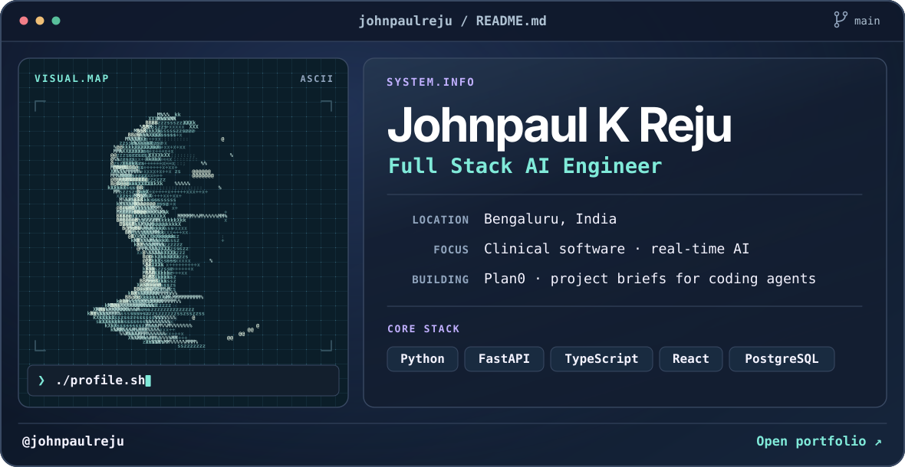
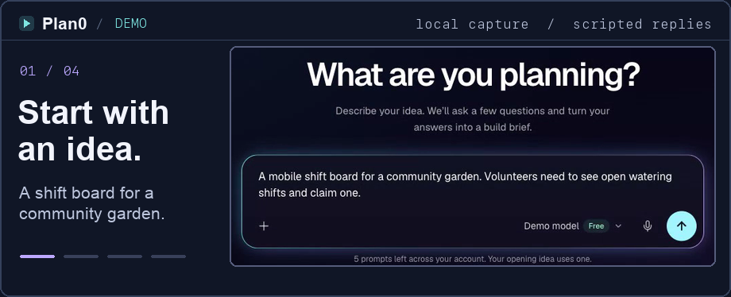
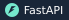

<a href="https://www.johnpaulreju.in/">
  <picture>
    <source media="(max-width: 620px) and (prefers-reduced-motion: no-preference) and (prefers-color-scheme: dark)" srcset="./assets/mobile-dark.svg">
    <source media="(max-width: 620px) and (prefers-reduced-motion: no-preference) and (prefers-color-scheme: light)" srcset="./assets/mobile-light.svg">
    <source media="(max-width: 620px) and (prefers-reduced-motion: reduce) and (prefers-color-scheme: dark)" srcset="./assets/mobile-dark-still.svg">
    <source media="(max-width: 620px) and (prefers-reduced-motion: reduce) and (prefers-color-scheme: light)" srcset="./assets/mobile-light-still.svg">
    <source media="(prefers-reduced-motion: no-preference) and (prefers-color-scheme: dark)" srcset="./dark.svg">
    <source media="(prefers-reduced-motion: no-preference) and (prefers-color-scheme: light)" srcset="./light.svg">
    <source media="(prefers-reduced-motion: reduce) and (prefers-color-scheme: dark)" srcset="./assets/dark-still.svg">
    <source media="(prefers-reduced-motion: reduce) and (prefers-color-scheme: light)" srcset="./assets/light-still.svg">
    
  </picture>
</a>

# Hi, I'm Johnpaul.

I'm a full stack AI engineer in Bengaluru. At Odyssey Therapeia, I built a clinical workspace where a doctor can open an appointment and start the AI scribe in the same view. I’ve also built real-time avatar chat, from the React interface to the FastAPI stream behind it.

[Portfolio](https://www.johnpaulreju.in/) · [Résumé](https://www.johnpaulreju.in/resume) · [Medium](https://medium.com/@johnpaulreju2k) · [Email](mailto:johnpaulreju2k@gmail.com)

## Inside Plan0

I’m building Plan0 to turn a software idea into a brief for a coding agent. In this recorded local demo, I start with a watering schedule for a community garden. After five scripted questions, I open the exported ZIP and find the volunteers, shift rules and first-release scope in `PRODUCT.md`.

<a href="https://www.johnpaulreju.in/watch/plan0-demo">
  <picture>
    <source media="(prefers-reduced-motion: no-preference)" srcset="./assets/plan0-demo.gif">
    
  </picture>
</a>

[Watch the full 42-second walkthrough](https://www.johnpaulreju.in/watch/plan0-demo) · [Visit Plan0](https://www.plan0.in/)

## Selected work

- **Portfolio OS** opens my projects as windows on desktop and as apps on a phone. Both interfaces read from the same profile. [Open the portfolio](https://www.johnpaulreju.in/) · [Explore the Next.js source](https://github.com/Johnpaulreju/My_portfolio)
- **Mafia Night** is a multiplayer social deduction game. The server keeps each player’s secret role and sends them the current round when they reconnect. [Explore the WebSocket game server](https://github.com/Johnpaulreju/mafia_imposter/tree/main/server)
- **From The Trunk** is a storefront for preloved sarees. I built most of it at Odyssey Therapeia, including the storefront design and payment integration. [Visit the storefront](https://www.fromthetrunk.shop/)
- **ICU mortality prediction** was my master’s research at Kristu Jayanti College. I studied how k-nearest neighbors could be used for the prediction task. [Open the research repository](https://github.com/Johnpaulreju/ICU-Mortality-rate-prediction-using-Ml-Algo)

## Engineering stack

       

I use TypeScript and React for interfaces, Python and FastAPI for streaming responses, and WebSocket and WebRTC for live conversations.

## Writing on Medium

- **Why Zerodha chose SQLite.** I looked at how Blobasaur stores chart preferences and what batching writes buys the team. [Read the database breakdown](https://medium.com/@johnpaulreju2k/why-zerodha-chose-sqlite-when-bigger-databases-were-available-85ecacf315b2)
- **Organic clicks went from 2 to 11.** Neel Raval and I examined which conclusions we could draw after several changes to From The Trunk, including a hyphen removal. [Read the attribution case study](https://medium.com/@johnpaulreju2k/we-removed-a-hyphen-organic-clicks-rose-450-here-is-what-the-data-really-said-e5230a5214ff)
- **From O(1) to O(n!).** A hands-on guide to what happens to runtime and memory as inputs get larger. [Read the code examples](https://medium.com/@johnpaulreju2k/from-o-1-to-o-n-a-friendly-guide-to-algorithm-complexity-with-real-code-bd84d28832ca)

## Miko, my Git Koi

  <picture>
    <source media="(prefers-reduced-motion: no-preference)" srcset="./assets/miko/aquarium.gif">
    
  </picture>

**Miko joined me on November 26, 2026.** He started his journey as a white koi with blue markings, taking a slow cruise around his tank.

My public GitHub contributions help him grow. The languages in the repositories I work on color his scales, and weekly streaks leave markings on his fins. His tank refreshes daily, so on your next visit you might catch him resting, feeding, or darting through the water. [How Git Koi works](https://github.com/yalongwastaken/git-koi)

[Watch my contributions ripple](https://sur1ive.github.io/contribution-fx/?user=Johnpaulreju&theme=ripple&palette=ocean&mode=dark#playground)

Outside work, I like gaming and cooking. [Connect on LinkedIn](https://www.linkedin.com/in/johnpaul-k-reju/)
