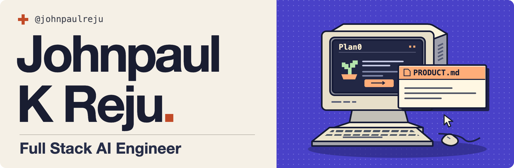

<h1>
  <a href="https://www.johnpaulreju.in/">
    <picture>
      <source media="(prefers-reduced-motion: no-preference)" srcset="./assets/plan0-desktop.svg">
      
    </picture>
  </a>
</h1>

I'm Johnpaul, a full stack AI engineer in Bengaluru. At Odyssey Therapeia, I built a clinical workspace where doctors can open an appointment and start the AI scribe in the same view. I also built real-time avatar chat, from the React interface to streaming responses in FastAPI.

[Portfolio](https://www.johnpaulreju.in/) · [Résumé](https://www.johnpaulreju.in/resume) · [LinkedIn](https://www.linkedin.com/in/johnpaul-k-reju/) · [Email](mailto:johnpaulreju2k@gmail.com)

## Things I've built

- **Plan0** is a tool I'm building to turn a software idea into a brief for a coding agent. In the local demo, I answer five questions about a community garden watering schedule and export the plan as Markdown. [Watch the 42-second demo](https://www.johnpaulreju.in/watch/plan0-demo)
- **Portfolio OS** puts my projects inside a windowed desktop. On a phone, the same apps open from a home screen. I built both views in Next.js with shared state in Zustand. [Explore the desktop](https://www.johnpaulreju.in/) · [Read the source](https://github.com/Johnpaulreju/My_portfolio)
- **Mafia Night** is my multiplayer social deduction game. A WebSocket server tracks the votes and secret roles, so a player who loses their connection can rejoin the same round. [Explore the game code](https://github.com/Johnpaulreju/mafia_imposter)

## On Medium

- **Why Zerodha chose SQLite.** What storing chart preferences has to do with batching writes and splitting data across files. [Read the engineering breakdown](https://medium.com/@johnpaulreju2k/why-zerodha-chose-sqlite-when-bigger-databases-were-available-85ecacf315b2)
- **What a 450% increase in clicks really meant.** At From The Trunk, organic clicks went from 2 to 11. Neel Raval and I looked at how much of that change we could attribute to removing a hyphen. [Read the case study](https://medium.com/@johnpaulreju2k/we-removed-a-hyphen-organic-clicks-rose-450-here-is-what-the-data-really-said-e5230a5214ff)
- **From O(1) to O(n!).** I used small code examples to show how runtime and memory grow as the input gets larger. [Read the code examples](https://medium.com/@johnpaulreju2k/from-o-1-to-o-n-a-friendly-guide-to-algorithm-complexity-with-real-code-bd84d28832ca)

Away from the keyboard, I like gaming and cooking.
